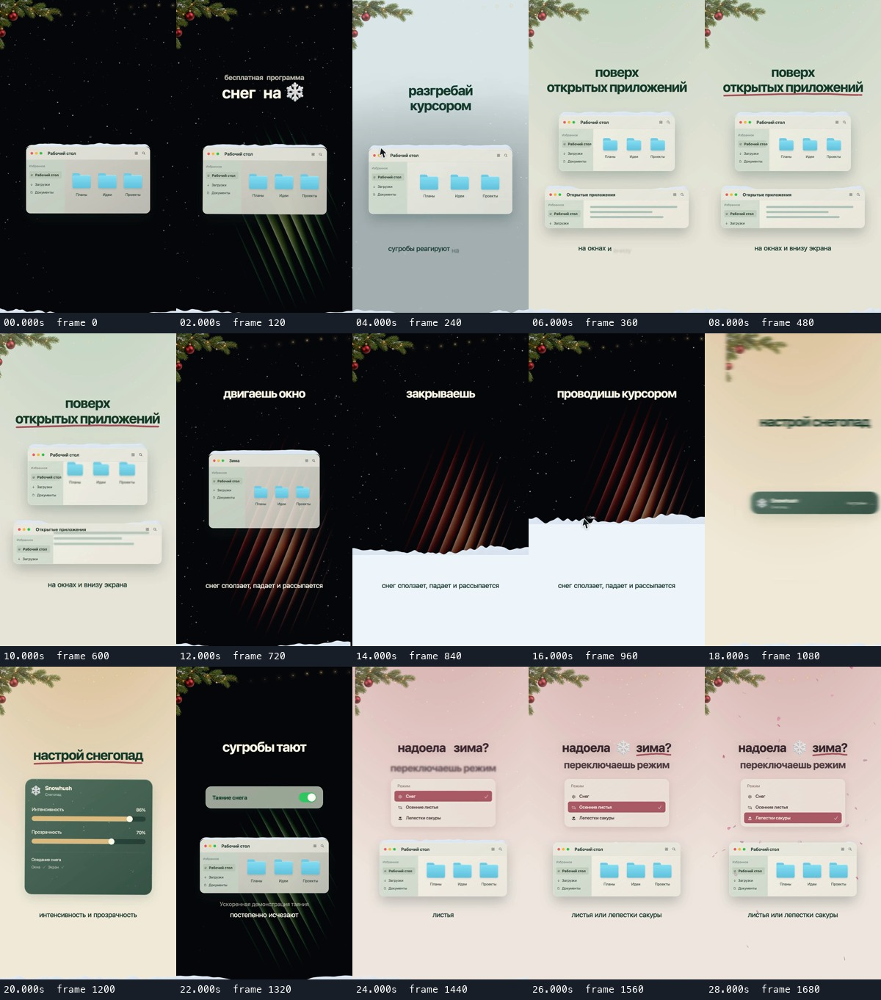
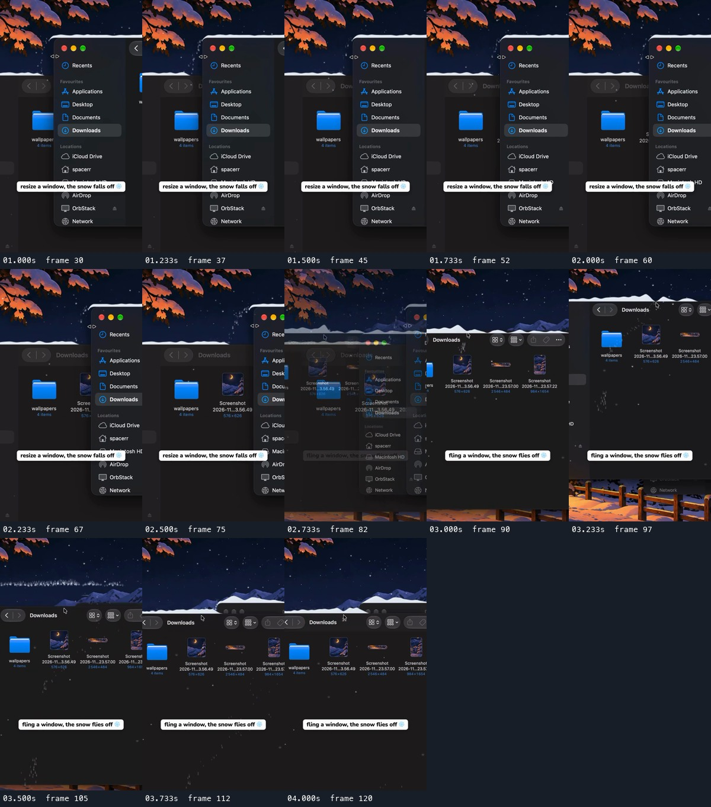
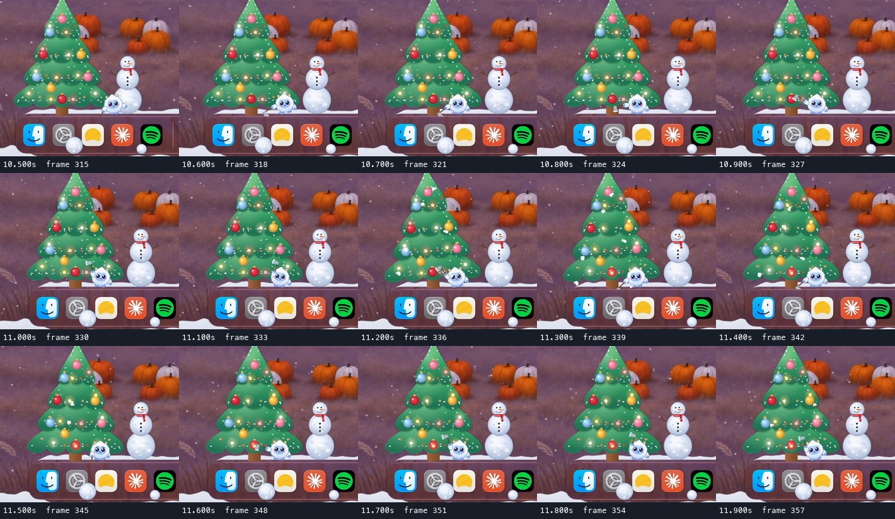
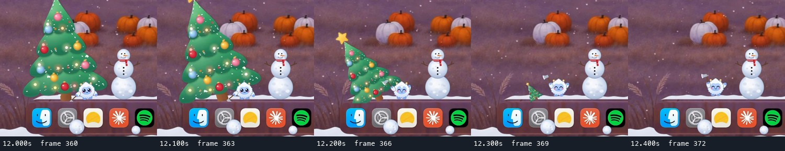
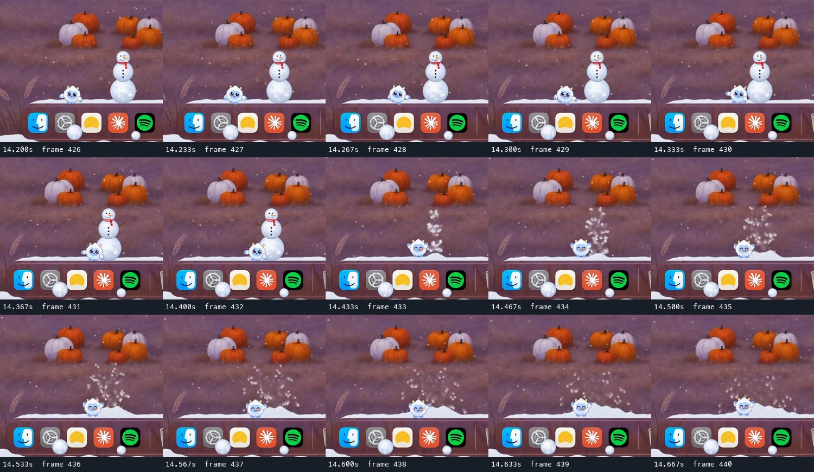
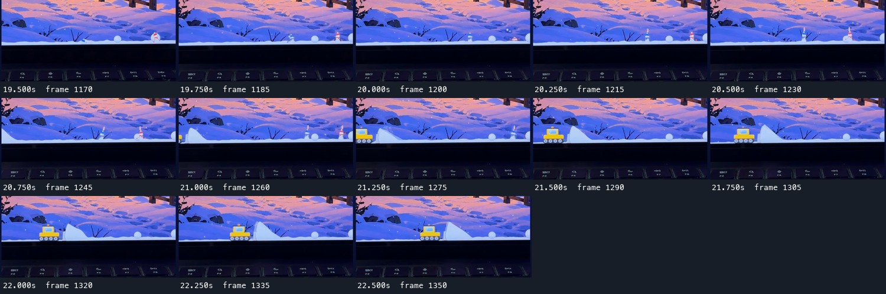
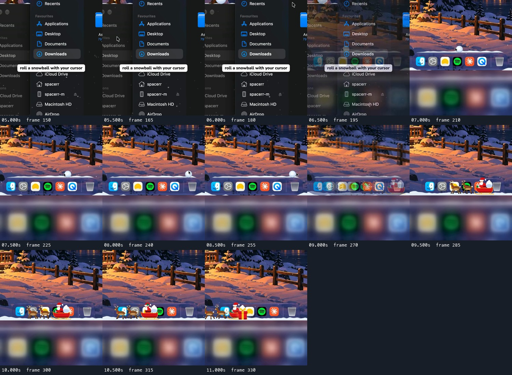
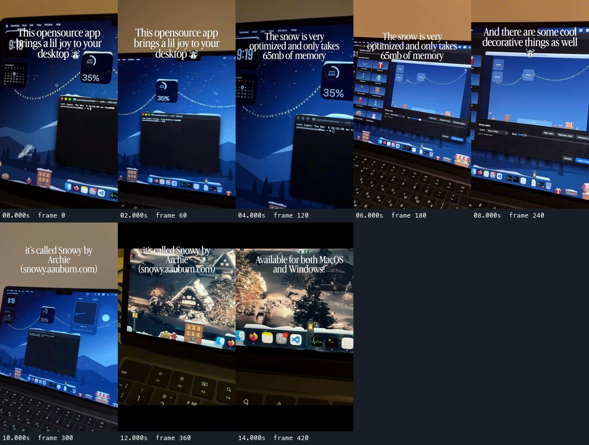

# SnowPlay: анализ шести видеореференсов

Дата: 13 ноября 2026. Объём уточнён пользователем: все шесть присланных ссылок. Это три продукта, а не шесть разных приложений. Результат этого прохода — исследование и спецификация; новые механики ещё не реализованы.

## Доказательства и точность

Все шесть исходных MP4 получены для локального анализа без извлечения cookies браузера. Всего 127,912 с, 5847 исходных видеокадров. Реестр `sources.json` содержит ссылки, разрешения, частоту записи, SHA-256 файлов и временные метки выбранных кадров. Оригиналы находятся в игнорируемой папке `media/`, не включаются в приложение. Авторские модели и код не переносились в SnowPlay.

Обзорные листы содержат кадры примерно через 2 с. Для ключевых эпизодов подготовлены последовательности через 0,5/0,25/0,2/0,1 с и один участок с каждым исходным кадром. Метка под изображением — PTS кадра файла и его номер с нуля. Скрипт выбирает кадры по их действительным PTS, а не считает время только по округлённому FPS. В `frames/<id>/<эпизод>/index.json` сохранён точный выбор и область кадрирования.

30/60 FPS здесь характеризуют запись, а не измеренную производительность программы. Монтаж, изменение масштаба и съёмка монитора не позволяют достоверно получить скорость в macOS pt/s, трение, массу или внутренний движок. Ни одна из трёх сторонних программ не установлена и не тестировалась как живое приложение. Доступность, пропуск кликов и расход памяти по ролику не доказаны. Аудиодорожки не транскрибировались; выводы опираются на видимые события и титры.

## Сравнительная карта

| № | Ролик | Продукт | Длительность / запись | Главная ценность | Качество свидетельства |
|---|---|---|---|---|---|
| R1 | [Dfoml0yis3P](https://www.instagram.com/reel/Dfoml0yis3P/) | Snowhush | 44,372 с / 1080×1920, 60 FPS | Снег как материал, окна, курсор, режимы | Преимущественно оформленная рекламная демонстрация; физику нельзя калибровать как по сырой записи |
| R2 | [DfSv9v1NwMb](https://www.instagram.com/reel/DfSv9v1NwMb/) | Koi / KoiArt | 14,372 с / 1080×1920, 30 FPS | Resize, бросок окна, кисть курсора, Dock | Видимые действия; есть монтажные переходы между примерами |
| R3 | [Dfms7IoNkOP](https://www.instagram.com/reel/Dfms7IoNkOP/) | Koi / KoiArt | 16,276 с / 720×1280, 30 FPS | Ёлка, сборка снеговика, Йети, разрушение | Самый полезный материал для причинных анимаций; отдельные сцены склеены |
| R4 | [Dfe_bS1tAnH](https://www.instagram.com/reel/Dfe_bS1tAnH/) | Koi / KoiArt | 22,685 с / 1080×1920, 60 FPS | Снежная дуэль, реакция на снегоуборщик | Съёмка монитора; персонажи малы, точную позу/контакт иногда не разобрать |
| R5 | [DfaegGeNZmh](https://www.instagram.com/reel/DfaegGeNZmh/) | Koi / KoiArt | 14,372 с / 1080×1920, 30 FPS | Снежок растёт/катится, Санта оставляет подарок | Запись с переходами; открытие подарка не показано |
| R6 | [DfnvIglK-Qp](https://www.instagram.com/reel/DfnvIglK-Qp/) | Snow by Archie | 15,835 с / 1080×1920, 30 FPS | Редактор сцены и креплений гирлянды | Съёмка под углом; текст о 65 MB — заявление автора, не наш замер |

Названия Koi/KoiArt видны в финальных карточках R2/R5. В R6 имя и адрес показаны внутри видео; указанный `snow.aauburn.com` при проверке не разрешился в DNS. Не подменяем его другим похожим продуктом. Четыре статичные иллюстрации в исходном сообщении не использованы как доказательство движения.

## 1. Snowhush — поведение слоя снега

[Источник R1](https://www.instagram.com/reel/Dfoml0yis3P/). Здоровье демонстрации: сценарий читается, но это недостаточное доказательство реального взаимодействия ОС.

| PTS / кадр | Наблюдение |
|---|---|
| 0–4 с / 0–240 | Слой на окне и внизу; указатель проходит по верхнему краю |
| 6–10 с / 360–600 | Показано распределение снега по нескольким окнам |
| 12–16 с / 720–960 | Монтажные примеры движения, закрытия и расчистки курсором |
| 20–22 с / 1200–1320 | Настройки количества/прозрачности, затем таяние |
| 24–30 с / 1440–1800 | Листья, лепестки и дождь — другие материалы |
| 32–36 с / 1920–2160 | Иллюстрация демонстрации экрана без эффекта у собеседника |

Живость создают связь поверхности с окном, неровная граница и продолжение движения после исчезновения опоры. Для SnowPlay полезны эти связи, а не дополнительные сезоны. Не доказаны точная длительность распада, механизм исключения из screen sharing и стоимость рендера.

## 2. Koi — окна и курсор

[Источник R2](https://www.instagram.com/reel/DfSv9v1NwMb/). Здоровье демонстрации: причинность видна, покадровая оценка ограничена склейками.

0–2,5 с: размер Finder меняется, край слоя обрывается вместе с сокращающейся опорой. Около 2,7 с — переход к другой сцене. На 3,233 с / f97 снег ещё над окном; на 3,500 с / f105 оторванная полоса находится выше нового положения окна. Это сильный визуальный признак инерции, но не доказательство конкретного физического решателя. Далее показаны очистка курсором примерно на 5–7 с и смахивание с Dock примерно на 8–10 с.

Для SnowPlay: различать перемещение и resize; потерявшие опору столбцы должны падать, а не масштабироваться вместе с окном. Курсор делает локальную выемку, а не очищает весь профиль. В этих кадрах не проверены перекрытие нескольких окон, fullscreen, автоскрытие Dock и hit-testing чужих приложений.

## 3. Koi — ёлка, сборка и Йети

[Источник R3](https://www.instagram.com/reel/Dfms7IoNkOP/). Здоровье: хорошо видны фазы действия и результат; есть смены кадрирования.

1–4 с: украшения выбираются наборами в меню. Отдельное перетаскивание игрушки и прогиб конкретной ветки не подтверждены. 5,233–6,000 с: виден растущий снежный шар; 6,500–7,733 с — подъём частей и завершение снеговика.

9,200–9,400 с / f276–282: указатель у команды удаления ёлки. Затем Йети подходит. На 10,5–12,0 с видны повторные замахи топором. f360 / 12,000 с — ёлка стоит; f363 / 12,100 с — уже наклонена; f369 / 12,300 с — почти скрылась вниз; f372 / 12,400 с — удалена. Уноса ёлки в этой записи нет.

В следующем эпизоде f432 / 14,400 с Йети находится вплотную к снеговику; f433 / 14,433 с — вместо снеговика облако частиц. Отдельный летящий снежок на кадрах f426–432 не различим. Следовательно, бросок с прицеливанием — наше предлагаемое расширение, не восстановленный факт.

Живость обеспечивают подготовка, предмет в руке, реакция цели после контакта и короткая завершающая поза. Точную лепку Koi в SnowPlay стоит заменить уже имеющейся помощью сборки.

## 4. Koi — дуэль и уборка

[Источник R4](https://www.instagram.com/reel/Dfe_bS1tAnH/). Здоровье: понятная история, слабее видны отдельные контакты из-за масштаба съёмки.

0–19 с: персонажи занимают разные позиции и обмениваются снежками, видны падения/восстановления. Это несколько ситуаций с титрами и монтажом, не один непрерывный эксперимент. В районе 20,5–20,75 с персонажи подскакивают/удаляются из полосы. Слева появляется снегоуборщик; между 21,000 с / f1260 и 22,500 с / f1350 он перемещается вправо, перед ним движется заметный снежный вал, позади полоса очищена.

Нужная связь для SnowPlay: ковш → захваченный снег → движущийся вал → чистая поверхность. Сам рост объёма и сохранение массы по этому видео измерить нельзя. Выезд машины и окончательная судьба всего вала не показаны: запись заканчивается во время прохода. Увоз за экран — проектное решение SnowPlay.

Дуэль выразительна, но постоянная автономная игра конфликтует с тихим рабочим столом. Предложение — конечный сценарий только в Play, после базовой уборки и профилирования.

## 5. Koi — снежок и доставка

[Источник R5](https://www.instagram.com/reel/DfaegGeNZmh/). Здоровье: понятная связь с курсором и Dock, длительность полёта изменена монтажом.

Начало повторяет resize/движение окон. На 5–6 с снежок показан у края окна. После перехода примерно на 6,5 с в 7–8,5 с он катится вдоль полосы над Dock за курсором. На 9 с — следующая сцена: Санта с санями проходит вдоль Dock, около 11 с / f330 остаётся подарок.

В этом ролике нет раскрытия парашюта, открытия коробки, таймера или салюта. Нельзя переносить их в список «увидели у Koi». В SnowPlay это уже самостоятельная существующая цепочка доставки.

Полезна читаемая точка контакта шара с поверхностью и сохранение объекта после ухода персонажа. Место над Dock удобно при постоянно видимом Dock, но у нашего пользователя есть автоскрытие. Независимую площадку лепки сохраняем; персонаж не должен требовать постоянного наведения вниз.

## 6. Snow by Archie — сцена и гирлянды

[Источник R6](https://www.instagram.com/reel/DfnvIglK-Qp/). Здоровье: редактор виден, но съёмка под углом не позволяет точно измерять геометрию.

0–4 с: снег на экране, украшения и окна. Примерно 6–8 с показан редактор сцены: видны линия гирлянды, узлы, цвет, провисание и команды добавления/удаления элементов. На 10 с — панель ветра с прямоугольной областью. На 12–14 с — другая сцена с предметами вдоль нижнего края.

Это подтверждает подход «редактировать сам объект в контексте», но не доказательство физики каждого провода или крепления к чужому окну. Титр про 65 MB — заявление автора; CPU/GPU и сопоставимость с SnowPlay не измерены. Показанные домики и дополнительные декорации не расширяют автоматически объём SnowPlay.

Для нас полезны визуальные ручки крепления и предпросмотр ветра. Полноценный редактор сцен слишком велик для минимального пульта. Гирлянды остаются выключены до отдельного возвращения функции; будущий редактор ограничить тремя понятными точками и одной регулировкой провисания.

## Техническая проверка доступного исходного проекта

Snowhush — единственный из трёх, чей репозиторий в этом проходе дополнительно исследован. Проверен commit `1a21f11236a5cc67efc5ca0f1e3b6934cca3cc9a`; это текущий исходник, не доказанно версия из ролика. Код изучен только для анализа, не переносился.

- [Renderer.swift](https://github.com/mbezruchko/Snowhush/blob/1a21f11236a5cc67efc5ca0f1e3b6934cca3cc9a/Sources/Snowhush/Renderer.swift): Metal/MTKView, переиспользуемые буферы частиц/высот, несколько буферов кадров, отдельные GPU-проходы. Это конкретный кандидат для сравнения с нынешним Core Graphics SnowPlay; экономию заранее не обещаем.
- [SnowLayer.swift](https://github.com/mbezruchko/Snowhush/blob/1a21f11236a5cc67efc5ca0f1e3b6934cca3cc9a/Sources/Snowhush/SnowLayer.swift): профиль столбцов, перераспределение слишком крутых склонов и сброс через открытые края. Важен перенос материала, а не одна сглаженная картинка.
- [SnowSimulation.swift](https://github.com/mbezruchko/Snowhush/blob/1a21f11236a5cc67efc5ca0f1e3b6934cca3cc9a/Sources/Snowhush/SnowSimulation.swift): перенос слоя учитывает сглаженную скорость/ускорение опоры, сцепление, скольжение и отрыв. Поэтому одного следования координатам окна недостаточно.
- [WindowTracker.swift](https://github.com/mbezruchko/Snowhush/blob/1a21f11236a5cc67efc5ca0f1e3b6934cca3cc9a/Sources/Snowhush/WindowTracker.swift) и [OverlayWindow.swift](https://github.com/mbezruchko/Snowhush/blob/1a21f11236a5cc67efc5ca0f1e3b6934cca3cc9a/Sources/Snowhush/OverlayWindow.swift): наряду с CG применяются приватные SkyLight-вызовы для части оконной геометрии/Spaces. Это подтверждено исходником, а не угадано по видео. Такой путь не соответствует требованию SnowPlay использовать публичные API. Отсюда реальное ограничение точного повторения некоторых переходов.

Для Koi и Snow by Archie внутренний движок, механизм ввода и модель разрешений не установлены. SpriteKit как способ нашей реализации не означает, что эти продукты используют SpriteKit.

## Проверка текущего SnowPlay по коду

| Место | Фактическое состояние | Следствие |
|---|---|---|
| `Coordinator.windowGeometry` | Пустой обработчик | Окно переносит профиль, но нет полноценного инерционного схода при рывке |
| `Coordinator.tick`, `SnowSurface.clearThrough` | Проход ковша обнуляет пройденные ячейки; финал вызывает `clear` | Нет отдельного запаса снега перед ковшом и учёта увезённого объёма |
| `detachWindowSnow` | Ограниченный burst; minimize снимает 25%, close — весь профиль | Уже есть база для отделения снега, но комья/вторичные удары ещё не выражены |
| `remove-tree` | Немедленно меняет `config.tree=false` | Нет подхода, топора, падения и завершения Йети |
| `Decorations`, `Snowballs` | Составные модели и исходные шары сборки уже есть | Можно добавить физический распад без замены существующих моделей |
| `tree_ornaments` | Один составной графический слой | Нет логических ID, креплений и маятника для отдельных игрушек |
| `AssetManager`, manifest | Нет Йети и топора | Полноценная новая сценка требует согласованных собственных ассетов; заглушки не подходят |
| `AnimationDirector` | Есть очередь активных эффектов, отмена, приоритет и бюджет 80 частиц | Расширять существующий механизм, не создавать второй планировщик |
| `InteractionController` | Малые InputPanel и явные редакторы | Новые персонажи остаются click-through; зоны нужны только для действий пользователя |

`Docs/Architecture.md`, `Feasibility.md` и части README содержат исторические описания запрета снега на окнах, 36 тестов и старой лепки. Они противоречат текущему коду и последним отчётам. Для этого исследования состояние взято из исходников; исторические измерения не выдаются за новые.

## Решения после критики

| Механика | Почему работает | Риск для рабочего Mac | Решение |
|---|---|---|---|
| Сход снега с окна | Остаётся движение после потери опоры | Большое облако закрывает текст | Ограниченный реальный объём, короткие комья и пыль |
| Снегоуборщик | Видимая причинность ковша и вала | Прямоугольный вал/исчезающая масса | Отдельный учёт переносимого снега и округлый профиль |
| Йети убирает ёлку | Ожидание → удар → падение → завершение | Сценка задерживает простую команду | Конечная короткая сценка, мгновенное тихое удаление в Focus/Reduce Motion |
| Удаление снеговика | Узнаваемая подготовка и ответ цели | Постоянная дуэль отвлекает | Один сценарий удаления; дуэль отложить |
| Игрушки на ёлке | Рука пользователя меняет объект | Слишком мелкие цели и точное попадание | Притягивание к креплению и редактор по запросу |
| Гирлянда | Понятные узлы, мягкая реакция | Сложный редактор и перехват кликов окна | Пока выключена; в будущем локальные ручки |
| Рендер снега | Много независимых частиц | Уже высокая нагрузка SnowPlay | Профилирование до наращивания персонажей, отдельный эксперимент Metal |

Следующий документ — [единая спецификация реализации](SnowPlay-Mechanics-Spec.md). Численные параметры там являются нашими стартовыми настройками, кроме явно отмеченных PTS референса.
