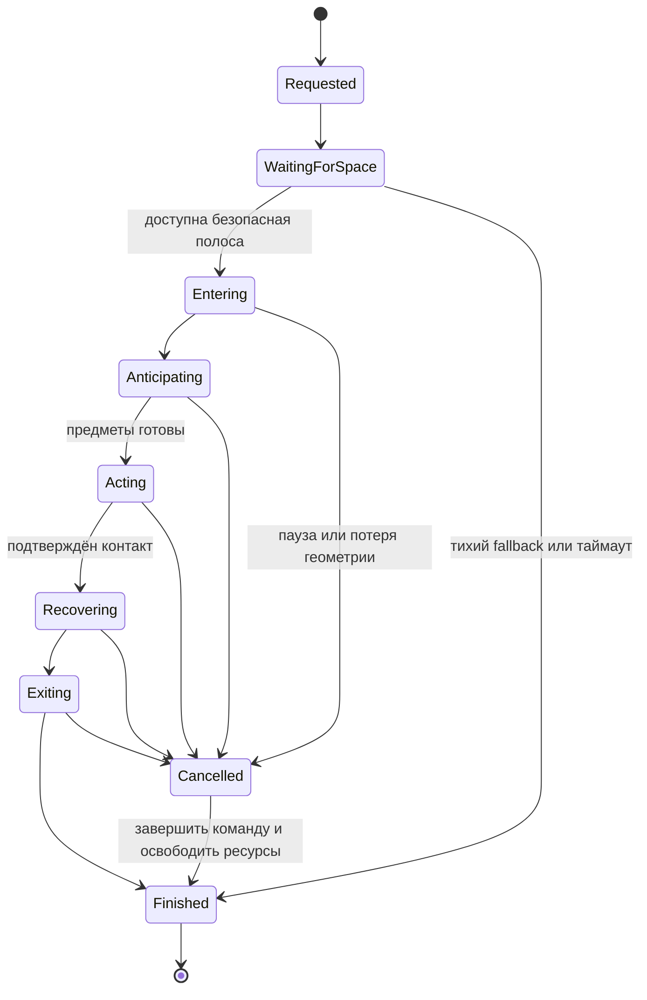
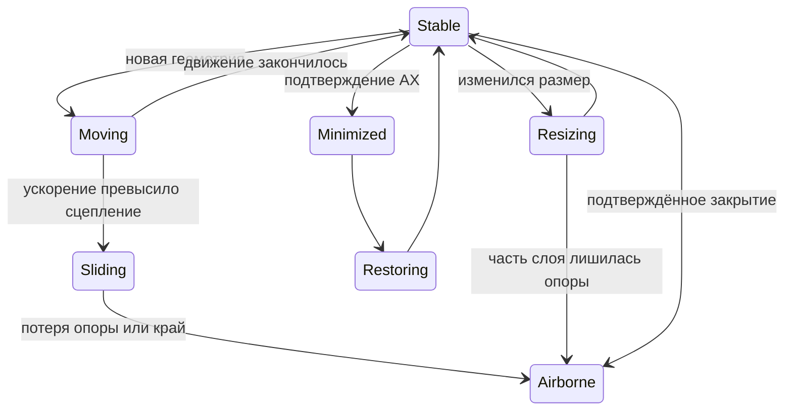
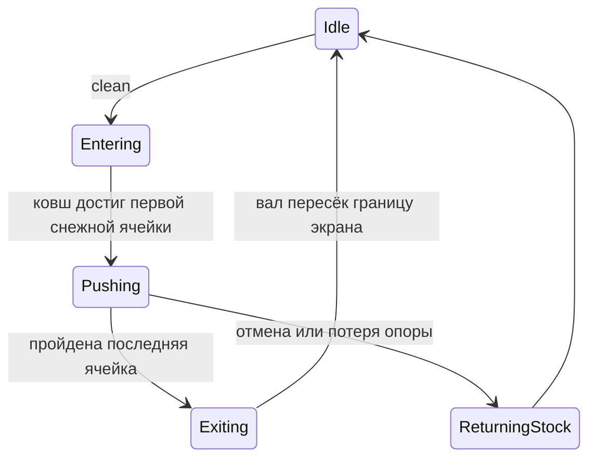
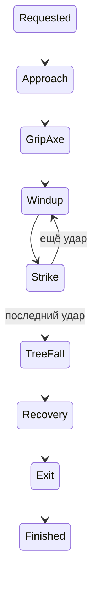
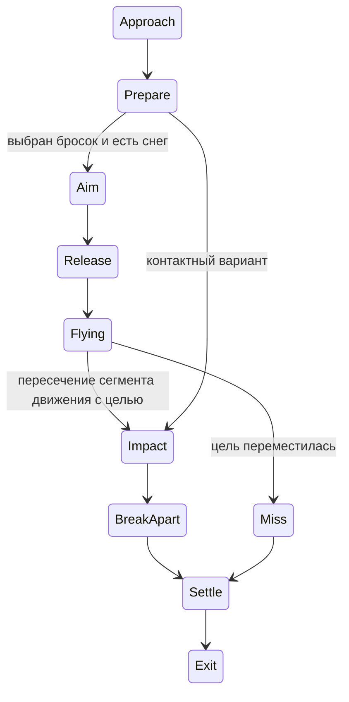
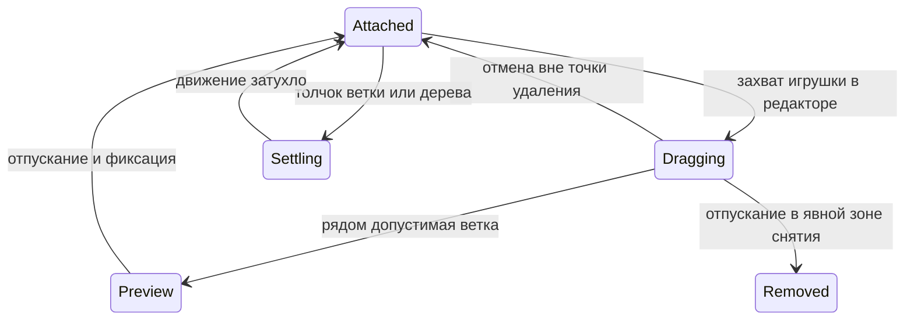

# SnowPlay: единая спецификация живых механик

Статус: проект реализации от 13 ноября 2026, основанный на [разборе шести референсов](Analysis.md) и текущем коде. Не отчёт о внедрении. Цель — связанное поведение материала, предметов и персонажей при сохранении обычной работы Mac.

## 1. Общие контракты

Сохраняются `WinterCoordinator`, `ParticleEngine`, `SurfaceManager`, `DecorationManager`, `AnimationDirector`, `AssetManager`, `InteractionController` и локальный API. Новые чистые модели состояний добавляются в SnowCore; AppKit/SpriteKit остаются адаптерами геометрии, ввода и изображения. Второго снежного движка, очереди эффектов или параллельной веб-системы нет.

Координаты физики — глобальные логические Quartz pt, начало сверху слева основного дисплея, Y вниз. Преобразование в AppKit/SpriteKit — на границе рендера. Скорости — pt/s, ускорения — pt/s², углы — радианы. Размер картинки не является массой. В существующей 2D-модели запас снега измеряется площадью профиля; снежный шар расходует πr². Не смешивать это с объёмом 3D-сферы.

Для активной механики хранить ID команды, ID цели, фазу, время, версию поверхности и принадлежащие ей временные узлы/частицы. Повторная команда той же цели не создаёт вторую сценку. Событие контакта исполняется один раз независимо от числа кадров. `AnimationDirector` продолжает ограничивать ресурсы; одновременно — одна крупная сценка персонажа, остальные разрешённые мелкие эффекты укладываются в существующий общий бюджет 80 временных частиц. Это более строгая политика поверх существующих трёх слотов, а не новый планировщик.

Общий жизненный цикл:

Команды удаления сразу сохраняют желаемое отсутствие объекта. Его прежний узел может временно перейти во владение сценки удаления, но больше не считается интерактивной постоянной моделью. Пауза, Escape, сон, fullscreen и перезапуск завершают удаление без воскрешения объекта. Отмена уборки сохраняет уже очищенную полосу; оставшийся переносимый снег возвращает на допустимую поверхность, а избыток переводит в ограниченные комья. Материал не пропадает молча.

## 2. Снег на окнах: накопление, движение, resize, закрытие

**Основание:** R1, R2. В проекте накопление/close/minimize уже есть; инерция движения отсутствует.

Профиль состоит из высот `h[i]` с шагом Δx; запас `M=Σh[i]·Δx`. Падение проверять по верхней поверхности `windowTop−h[i]`, с учётом перекрытий. Слишком крутой склон перераспределяет массу между соседями; за открытым краем она переходит в движущиеся комья. Одного рисования волнистого контура недостаточно.

Из последовательности геометрии вычислять скорость и сглаженное ускорение. Малый дрейф окна переносит слой; резкая смена скорости создаёт относительное движение снега против ускорения опоры. Начальная гипотеза: фильтр 80–120 мс и отрыв после устойчивого порога 2–3 выборки. Порог подобрать на реальном drag, не брать из рекламного монтажа. При отпускании окна скорость профиля затухает; окно не должно продолжать «трястись» от шума CG.

Resize обрабатывать отдельно от переноса: сохранять высоты в мировых координатах на сохранившейся части верхней кромки. Убранная опора создаёт падающий снег, новая ширина начинается пустой. Не растягивать снежную текстуру и не вычислять сильный бросок только из движения resize-границы.

Close/minimize: использовать последнюю достоверную геометрию до анимации Dock. Сохранить нынешнюю политику 75% запаса при minimize; отделённые 25% становятся комьями. Close отделяет весь остаток. Комья могут распасться на ограниченную пыль при первом столкновении с нижней разрешённой поверхностью. Нужный пользователю местный slowdown 3–5 с подключить через существующие `SnowTimeRegion`; замедляется только область бывшего окна. Сейчас `detachWindowSnow` не задаёт регион, несмотря на наличие типов часов в движке.

Пропажа окна из on-screen списка не равна закрытию: Spaces, скрытие и minimize различать существующим наблюдателем. Не собирать заголовки и содержимое чужих окон.

## 3. Снегоуборщик и видимый перенос снега

**Основание:** R4, 21,000–22,500 с. Исчезновение снега за ковшом видно; точный баланс массы в референсе не измерен.

Заменить destructive `clearThrough` на перенос: снять реальный объём только из нового участка прохода и добавить его в `carriedVolume`. Повторная обработка кадра/участка не снимает снег второй раз. Пока вал движется, он является частью общего состояния материала.

Перед ковшом рисовать отдельный округлый профиль с площадью, соответствующей видимой части `carriedVolume`; при переполнении визуальной ёмкости остаток остаётся учтённым в машине, а не увеличивает вал до размера окна. Небольшая пыль расходует тот же запас и бюджет частиц. За ковшом остаётся очищенная поверхность; новый падающий снег после прохода может оседать вновь. Не вызывать глобальный `clear()` в конце обычной уборки.

Колёса: угол `θ += distance/radius`, а не фиксированное число оборотов за любое расстояние. Корпус слегка реагирует на профиль, ковш остаётся привязан к линии контакта. Направление, точка ковша и параметры вертикального Dock — из существующего `PlowSweep`. Радиус контакта проверять в тех же pt, что и очистку.

При уходе за границу учтённый запас становится `exportedVolume`: это явно вывезенный снег. При отмене до выезда — вернуть запас на доступную поверхность рядом с ковшом; если профиль заполнен, остаток остаётся в очереди ограниченной повторной депозиции, не требует тысяч новых частиц. Focus/Reduce Motion — тихая конечная уборка с явно учтённым удалением, без персонажной сценки.

Автоскрытый Dock не удерживать системной настройкой. Если опора/полоса недоступна, отложить анимацию либо выполнить тихую уборку с понятным статусом. Не показывать движущийся ковш вдали от физического профиля. Автоматическая уборка не прерывает лепку.

## 4. Йети удаляет ёлку

**Основание:** R3; подход, повторные замахи и падение подтверждены. Унос дерева не показан.

Старт — существующая команда `remove-tree`. Не добавлять второго переключателя удаления. Размер Йети первоначально 28–40 pt, ёлки — существующий 50–90 pt. Путь проходит только по свободной площадке и не пересекает рабочие окна. Для длинного маршрута персонаж появляется ближе к цели за допустимой границей/краем площадки; не заставлять ждать десятки секунд.

Стартовые длительности SnowPlay, не измерения референса: подход 0,4–1,0 с; подготовка 0,2 с; три цикла удара по 0,3–0,4 с; падение 0,35–0,55 с; завершение и уход 0,5–0,8 с. Анимация конечна. В тихом режиме либо при отсутствии нужного ассета — обычное быстрое удаление; сломанная сценка не блокирует кнопку.

Иерархия: корень с положением стоп → корпус → плечо → предплечье → кисть → топор. Точка хвата топора совпадает с кистью во всех кадрах. Точка удара лезвия достигает ствола до толчка дерева. Ёлка вращается вокруг основания ствола; игрушки наследуют её transform, не остаются висеть отдельно. На последнем ударе — небольшая отдача и отрыв снега с ёлки. Во время падения снежный запас её поверхности переносится в доступные нижние поверхности/частицы.

В первой версии дерево падает и удаляется; унос потребует отдельных поз и второго сценария контакта, поэтому не маскируется телепортацией. Повторное «Убрать» не вызывает второго Йети. Восстановление ёлки пользователем во время удаления сначала завершает старую сценку, затем открывает обычное размещение новой.

## 5. Удаление снеговика и вариант броска

**Основание:** R3, f432→433. Контактное разрушение подтверждено; бросок — предложенная новая механика.

Для первого варианта: подход → подготовка → контакт → распад → короткая реакция → уход. Новая команда `remove-snowman` доступна в дополнительных действиях, рядом с существующей лепкой; главные три кнопки пульта сохраняются.

Вариант пользователя с броском: подготовить снежок из доступного запаса → прицелиться → отпустить → полёт → столкновение → распад. До отделения снежок — дочерний узел кисти; на событии release перейти в мировые координаты без скачка. Начальная скорость для заданных цели и времени T: `v0=(target−start)/T−g·T/2`; полёт по `p=start+v0·t+g·t²/2`. Для движущейся цели нужен прогноз или контролируемый промах, а не доводка снаряда к цели на последнем кадре. Если запас недостаточен, не создавать физическую массу из ничего: использовать контактное удаление.

Использовать три исходных шара `assemblyBalls` и существующие детали. Сумма площади шаров задаёт запас снеговика. При ударе центр масс сдвигается по импульсу, шары расходятся и оседают; декоративные нос/шарф не считаются снегом. Пыль не заменяет всю массу. Общий запас после удара — нижние профили + комья + явно растаявшая доля. Событие impact должно выдерживать большой шаг времени: проверять пересечение сегмента между прошлой и новой позицией, не только точку кадра.

Постоянная автономная дуэль из R4 не входит в первый этап. Если вернуться к ней, только по явному запуску в Play, с конечным временем и взаимным исключением со снегоуборщиком.

## 6. Лепка, игрушки и крепления

**Лепка.** Сохранить независимую площадку 300×150 pt и нынешнюю автоматическую сборку после раскатывания. Вращение шара связывать с пройденным расстоянием, рост — со снятым запасом, отпускание — с мягким коротким торможением. Не возвращать обязательное точное складывание в полосе автоскрытого Dock из R3/R5. Сборка из трёх шаров и появление лица/шарфа остаются поэтапными.

**Игрушки.** Перетаскивание отдельной игрушки — новая функция SnowPlay, а не установленный факт R3. У каждой нужны устойчивый ID, локальная точка подвеса, состояние и маленькая область ввода только в явном редакторе ёлки.

Притягивание к свободным якорям в пределах 8–12 pt; радиус настраивается разработчиком по тесту читаемости, не отдельным пользовательским ползунком. После фиксации угол игрушки подчиняется затухающему маятнику; стартовый угол до 6°, успокоение примерно за 0,8–1,2 с. Реакция ветки начинается в момент передачи нагрузки, не до касания. Когда ёлку перемещают или наклоняют, все якоря остаются в её локальной системе координат.

Не прикручивать независимую физическую симуляцию ко всем неподвижным игрушкам. Короткий аналитический spring включается только на время реакции. Для настоящего локального прогиба ветки нужна разбивка кроны на управляемые части; монолитный `tree_foliage` этого сам не даёт. До такой подготовки допустим только честно обозначенный общий мягкий наклон кроны.

## 7. Сохранить существующую систему

| Функция | Решение этого проекта |
|---|---|
| Количество, скорость, направление снега | Нынешние два ползунка и стрелка; не вводить второй набор параметров |
| Focus / Balanced / Play | Меняют существующую конфигурацию и политику сценок |
| Санта | Существующая редкая доставка каждые 5 минут и ручная команда; без постоянных пролётов |
| Парашют / подарок | Сохранить составную модель, открытие первым кликом, удаление коробки через 3 с и отсчёта через 12 с; это функции SnowPlay, не подтверждённые R5 |
| Таймер Нового года | Считать от реального Date; следующий календарный год, не замороженная надпись 2027 |
| Шапочки | Сохранить три цвета и текущую публичную AX-привязку; не связывать их с новым редактором ёлки |
| Иней | Нынешний тонкий слой и затухание; не превращать в сплошную маску окна |
| Гирлянды | По текущему решению выключены; R6 — материал для будущего компактного редактора, не основание включить их автоматически |
| Салют | Один небольшой эффект в существующем бюджете; без звука и вспышек на весь экран |
| Сброс / сон / пауза | Завершают сценарии и освобождают временные узлы, input panels и переносимый запас |

Mochi, Puffy, Bubi, камин, лопата, коллекционные подарки и домики не возвращаются через референсы. Йети — отдельно предложенный новый актёр, не переименование исключённого персонажа.

## 8. Ресурсы и взаимодействие с macOS

Предоставленные SVG/PNG остаются основой. Для игрушек можно подготовить производные из отдельных исходных примитивов `tree_ornaments.svg`, с сохранением исходника и происхождения каждого ID. Для Йети и топора в библиотеке нет подходящих моделей: нужен отдельный набор собственного Soft 2D Cartoon-арта, с точками стоп, плеч, кистей и хвата. Не вырезать персонажа из рекламного ролика и не заменять эмодзи. До наличия ресурсов анимированное удаление остаётся недоступной веткой с рабочим тихим fallback.

Использовать маленькие дочерние SKNode с общими текстурами, не создавать текстуры на каждом кадре. `SKPhysicsJointPin` может соединять физические тела вокруг точки; для нескольких декоративных подвесов достаточно более дешёвого аналитического маятника. Это наше инженерное решение, не установленная технология Koi. [Apple: SKPhysicsJointPin](https://developer.apple.com/documentation/spritekit/skphysicsjointpin).

Прозрачное окно с `ignoresMouseEvents=true` пропускает мышь целиком; выборочные интерактивные зоны обеспечиваются существующими малыми InputPanel. Сам Йети, топор, летящий снежок, снег и машина кликов не принимают. [Apple: ignoresMouseEvents](https://developer.apple.com/documentation/appkit/nswindow/ignoresmouseevents).

`CGWindowListCopyWindowInfo` даёт геометрию/метаданные, а не готовую сцену физических тел. Его вызовы относительно дороги: опрашивать адаптивно, повышая частоту только на время движения. AX-наблюдатель относится к конкретному приложению; сообщения могут не поддерживаться, разрешение может быть отозвано. Нынешние наблюдатели/проверку доверия переиспользовать. Дополнительного разрешения «на накопление предметов» в архитектуре нет. [Apple: CGWindowListCopyWindowInfo](https://developer.apple.com/documentation/coregraphics/cgwindowlistcopywindowinfo(_:_:)), [AXObserverCreate](https://developer.apple.com/documentation/applicationservices/1460133-axobservercreate), [AXObserverAddNotification](https://developer.apple.com/documentation/applicationservices/1462089-axobserveraddnotification).

Публичные уровни и collection behavior управляют общим положением окон. Они не дают надёжного способа встроить свой слой произвольно между любыми двумя чужими окнами. При перекрытии применять маски/скрытие и отложенный сценарий, а не приватный SkyLight из референса. Для fullscreen, Spaces и Stage Manager необходимы реальные отдельные проверки; `.canJoinAllSpaces` сам по себе не доказывает корректность. [Apple: NSWindow.Level](https://developer.apple.com/documentation/appkit/nswindow/level-swift.struct), [CollectionBehavior](https://developer.apple.com/documentation/appkit/nswindow/collectionbehavior-swift.struct).

## 9. Порядок внедрения и критерии готовности

1. **Базовая производительность.** Повторяемая сцена, одна машина/экран, одинаковая плотность и питание. Профиль CPU/GPU/памяти и фактического показа кадров; отдельно стоимость физики, наблюдения окон, canvas и SpriteKit. В сохранённом [замере SnowPlay](../more-snow-performance.json) Play с 2400 частицами и активными сценами — около 58% одного ядра. Это уже превышает цель, поэтому не наращивать постоянно активные системы. Эксперимент Metal допустим как замена только рендера частиц с сохранением Physics/SurfaceManager и быстрым возвратом к прежнему пути; выигрыш должен быть измерен, не предположен.
2. **Материал и окна.** Внедрить перенос массы, верхнюю поверхность, resize и инерцию в `SnowCore/Surface.swift`, `Particles.swift`, `Coordinator.windowGeometry`. Критерий: после движения/resize нет плавающего профиля, материал перенесён, нет повторного списания.
3. **Настоящая уборка.** Добавить чистое состояние `PlowLoad` в SnowCore; использовать существующие `clean`, `PlowSweep` и узлы машины. Критерий: растущий вал перед ковшом и сохранение/экспорт массы, а не глобальное исчезновение.
4. **Ресурсы и риг Йети.** Подготовить список арта/якорей, проверить хват, контакт и читаемость в 28–40 pt. До этого не объявлять сценку реализованной.
5. **Два конечных удаления.** Расширить EffectKind/AnimationDirector и DecorationState; сохранить `remove-tree`, добавить `remove-snowman` без изменения старых контрактов. Критерий: один запрос — один актёр — один результат; сон/пауза/повторная команда не оставляют узлы.
6. **Игрушки и редактор по запросу.** Производные существующего арта, логические ID, якоря, магнит и короткий spring. Критерий: перестановка и снятие с первого действия, точки следуют за ёлкой, редактор не захватывает посторонние клики.
7. **Визуальное сравнение.** Собственные записи SnowPlay и референс рядом; сравнивать конкретные фазы и точки контакта, не масштаб разных видеомонтажей. Повторный профиль и совместимость ОС. Только после этого решать вопрос о дуэлях/возврате гирлянд.

## 10. Проверяемая матрица

Это будущие тесты, не отметки о выполнении. Допуск массы — относительный 10⁻⁴ в чистом детерминированном тесте без нового снегопада/таяния. Порог пиксельного сравнения привязать к масштабу 1×/2×.

| ID | Действие | Проверка |
|---|---|---|
| M01 | Ковш пересёк участок дважды из-за повторного update | Изъятый запас учтён один раз |
| M02 | Обычный проход | Уменьшение профиля = переносимый + осевший + экспортированный снег |
| M03 | Отмена прохода на 40% | Пройденная полоса остаётся; переносимый запас возвращён/учтён; машина и хит-зоны удалены |
| M04 | Полный профиль и переполненный ковш | Остаток не теряется, не порождает неограниченные частицы |
| W01 | Медленно переместить окно, затем резко остановить | Тихий перенос и выраженный ограниченный инерционный сход различаются |
| W02 | Сузить левую/правую сторону | Сохранившийся слой не растянут; потерявший опору снег падает |
| W03 | Minimize/restore/close подряд | Исходная геометрия, запас и местные часы не дублируются |
| W04 | Смена Spaces / временная пропажа CG | Не считается закрытием, нет ложного выброса |
| W05 | Отозвать AX во время движения | Без аварии, угадывания закрытия и новой системной просьбы без действия пользователя |
| Y01 | Дважды нажать «Убрать ёлку» | Один сценарий; дерево не возрождается после завершения/перезапуска |
| Y02 | Просмотреть каждый кадр замаха | Хват совпадает с кистью, лезвие касается ствола до реакции; стопы не скользят |
| Y03 | Окно закрывает цель перед ударом | Сценка безопасно заканчивается/переходит в тихое удаление; чужие клики доступны |
| Y04 | Pause/Escape/sleep в каждой фазе | Желаемое удаление завершено, временные узлы/ресурсы/панели освобождены |
| S01 | Удар по снеговику | Распад только после контакта; сумма массы шаров сохранена |
| S02 | Снежок пролетает сквозь цель за один большой dt | Swept collision находит удар, без повторного impact |
| S03 | Цель перемещена после броска | Корректный промах, нет телепортации снаряда |
| B01 | Автоскрыть Dock и слепить снеговика | Площадка независима, не надо удерживать курсор у нижней границы |
| T01 | Перенести/снять игрушку, отменить drag | Магнит/удаление понятны, исходный объект не дублируется |
| T02 | Переместить/удалить ёлку во время качания | Локальные якоря и освобождение ресурсов корректны |
| A01 | Включить Reduce Motion / Focus | Нет бросков, рубки и автономных дуэлей; команды остаются работоспособны |
| A02 | 1×/2×, горизонтальный/боковой Dock, второй монитор | Масштаб без растяжения, общая система координат, нет двойного актёра |
| A03 | Проверить чужие кнопки под каждой фазой | Нет захвата ввода кроме явно открытого редактора и самих интерактивных объектов |
| P01 | 100 циклов сценки после прогрева | Число узлов/текстур/панелей возвращается к базе; память не растёт монотонно |
| P02 | 5 минут Focus/Balanced/Play + 30 минут худшего сценария | CPU/GPU/память и показ кадров измерены; не подменять показ FPS частотой таймера |

Визуальную приёмку проводить на запущенном macOS-приложении с собственными тестовыми окнами. Готовые видео и проходящие тесты математики не заменяют эту проверку.
